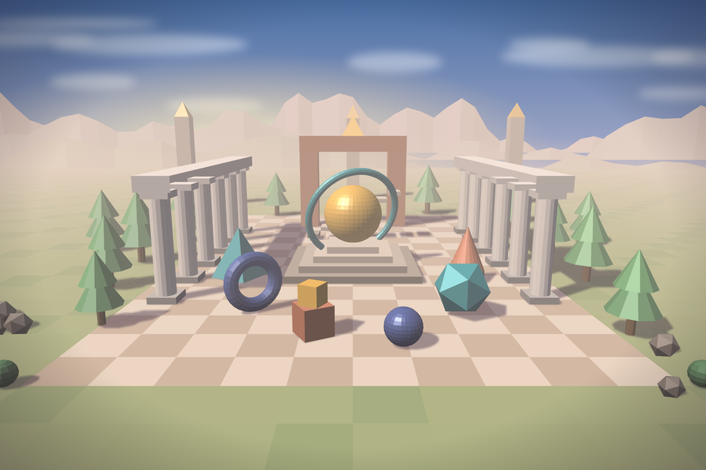
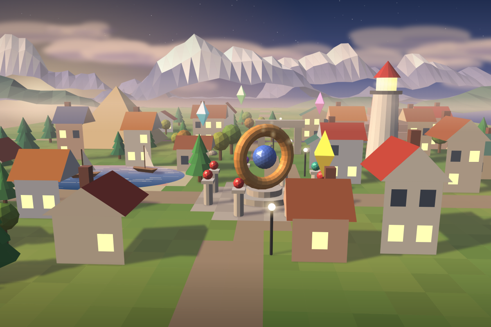
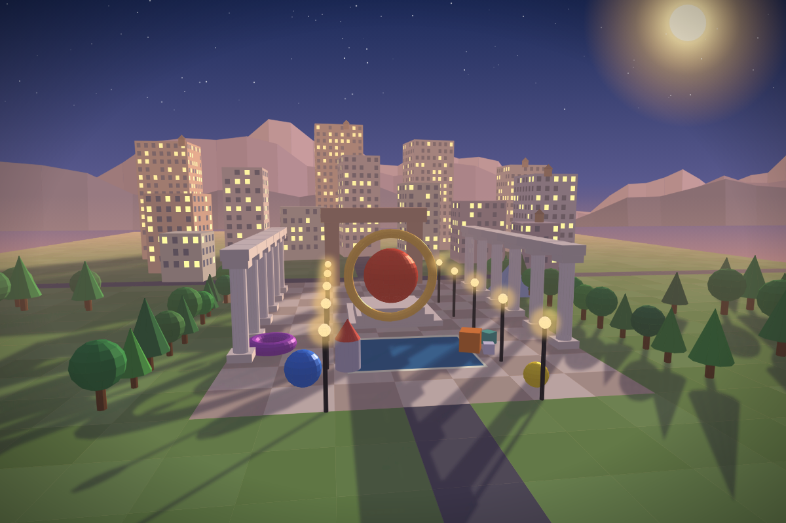
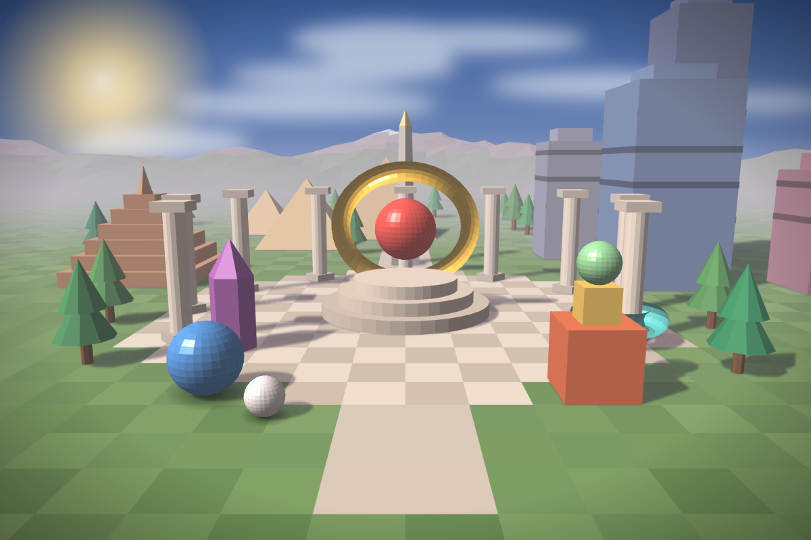

# minipy

A minimal agent harness for [Harbor](https://github.com/harbor-framework/harbor) where the model has exactly one tool: write a Python script and run it.

There is no shell tool, no file editor and no persistent interpreter. Each `run_python` call saves the code as a new file in the task container, runs it with `python3`, and returns the exit code, stdout and stderr. Variables do not carry over between calls; files do. To run other programs, the model uses `subprocess` from inside its script.

The whole harness is one file, [`minipy_agent.py`](minipy_agent.py), of about 230 lines.

## How it works

- **One tool.** `run_python(code, timeout_sec?)`. Output is clipped to 20,000 characters per stream (head and tail kept).
- **Loop.** The run ends when the model replies without a tool call, refuses, or reaches `max_steps`.
- **Model calls.** Claude via the Anthropic Python SDK: streaming, adaptive thinking, prompt caching, and the assistant turn appended to history unchanged.
- **Setup.** If the task image has no `python3`, the harness installs it with the image's package manager before the model starts. The model never sees this step.
- **Logs.** Every step is written to `agent/trajectory.jsonl` in the trial folder, including which model answered.

## Install

```bash
uv venv && uv pip install -e .
```

You also need Docker, and an Anthropic credential: `ANTHROPIC_API_KEY`, or an `ant auth login` profile, which the SDK picks up automatically.

## Run on Terminal-Bench

```bash
harbor run -d terminal-bench/terminal-bench@4.1.0 \
  -a minipy_agent:MiniPyAgent -m anthropic/claude-opus-5-5 \
  --ak effort=medium --ak fallbacks=none -n 3
```

Run it from the repo root, or put the repo on `PYTHONPATH`, so Harbor can import `minipy_agent`. For a machine without a GPU, use `terminal-bench/terminal-bench-cpu@4.1.0` (63 tasks).

### Options (`--ak name=value`)

| Option | Default | Meaning |
|---|---|---|
| `effort` | `high` | Claude effort level: `low`, `medium`, `high`, `xhigh`, `max`. |
| `max_steps` | `200` | Maximum model calls per task. |
| `max_output_chars` | `20000` | Per-stream clip for script stdout and stderr. |
| `fallbacks` | `default` | `default` lets the API re-run a refused request on another model. Use `none` for benchmark numbers, so every step comes from the model you named. |
| `install_python` | `true` | Install `python3` in the task image if it is missing. |

## Example: one prompt, four harnesses

[`examples/svg-compare`](examples/svg-compare) runs the same task through minipy, Claude Code, mini-swe-agent and Pi: build a complex 3D scene as a static 1200×800 SVG. All four used Claude Opus 5.5 at medium effort, one attempt each, in identical Harbor containers.

| minipy | Claude Code |
|---|---|
|  |  |
| **mini-swe-agent** | **Pi** |
|  |  |

| Harness | Cost | Agent time | Turns | Output tokens |
|---|---|---|---|---|
| Pi | $0.30 | 2m 04s | 7 | 10,836 |
| minipy | $0.52 | 3m 09s | 11 | 18,139 |
| Claude Code | $0.63 | 3m 37s | 12 | 21,362 |
| mini-swe-agent | $0.71 | 4m 17s | 16 | 23,824 |

This is one run per harness, so treat it as a sample, not a ranking. Cost is at Opus 5.5 list prices.

To reproduce it:

```bash
ANTHROPIC_API_KEY=... examples/svg-compare/run.sh
```
